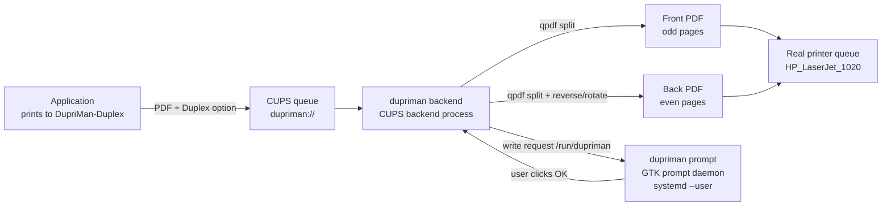

# DupriMan — Manual Duplex Printing Assistant

Gives **single-sided printers** a near-automatic duplex experience:
In any application's print dialog, select the virtual printer **DupriMan-Duplex** and choose
**Off / Long-edge / Short-edge** duplex. It will:

1. Print **all fronts** (odd pages, all copies);
2. Show a GTK dialog prompting to reinsert the paper;
3. Print **all backs** (even pages) after you click **OK**.

## Architecture



- **Backend** (`dupriman backend`, called by cupsd): parses duplex options, splits odd/even pages with qpdf, submits to the real queue and **waits for physical completion** before proceeding.
- **Prompt daemon** (`dupriman prompt`, runs in the user's graphical session): CUPS backends run as the `cups` user and cannot show dialogs, so they communicate via request/response files in `/run/dupriman`. The daemon shows a GTK4 dialog. Cancel or timeout safely aborts the back-side job.
- **Multiple copies**: The PPD declares `cupsManualCopies`, so copies are passed through to the real queue — all fronts (×N) first, one prompt, then all backs (×N).

## Dependencies

Runtime: `cups`, `qpdf`, `poppler` (pdfinfo), `gtk4` (≥ 4.10), `systemd`
Build: `rust` / `cargo`, `pkg-config`

Arch Linux:

```bash
sudo pacman -S --needed cups qpdf poppler gtk4 rust
```

## Installation

### From source

```bash
cargo build --release
sudo ./target/release/dupriman install
```

`install` places files according to FHS and activates them:

| Path | Description |
|---|---|
| `/usr/bin/dupriman` | Main binary |
| `/usr/lib/cups/backend/dupriman` | CUPS backend (symlink) |
| `/usr/share/cups/model/dupriman.ppd` | Virtual printer PPD |
| `/etc/dupriman/config.toml` | System-wide config (not overwritten if exists) |
| `/usr/lib/systemd/user/dupriman-prompt.service` | Prompt daemon (globally enabled) |
| `/usr/lib/tmpfiles.d/dupriman.conf` | State/spool directories |

Then start (or re-login) the prompt service:

```bash
systemctl --user start dupriman-prompt
dupriman test   # environment self-check
```

### Arch packaging

```bash
cd packaging && makepkg -si
```

`package()` uses `dupriman install --root "$pkgdir" --no-activate`,
and `post_install` uses `--activate-only` to finish registration.

## Configuration

System-wide: `/etc/dupriman/config.toml`; user-level override: `~/.config/dupriman/config.toml`
(only write fields you want to override). Full annotated example: `dupriman sample-config`.

Key options (defaults work for most face-down-output laser printers):

```toml
[printer]
real = "HP_LaserJet_1020"        # Real printer queue name, check with lpstat -v

[duplex]
even_order = "reverse"           # Back page order: reverse | normal

[duplex.long_edge]
even_rotate = 180                # Long-edge flip: back rotation angle

[duplex.short_edge]
even_rotate = 0                  # Short-edge flip: back rotation angle

[prompt]
language = "auto"                # Dialog language: auto | en | zh_CN | zh_TW
timeout_secs = 600               # 0 = wait forever; timeout aborts
```

### Internationalization (i18n)

Dialog text is selected by `prompt.language`:

| Value | Language |
|---|---|
| `auto` | Detect from `LANG` / `LC_ALL` (default) |
| `en` / `en_US` | English |
| `zh_CN` | Simplified Chinese |
| `zh_TW` | Traditional Chinese |

You can also override any text directly:

```toml
[prompt]
title = "My Custom Title"
message = "Please reinsert the paper"
ok_label = "Continue"
cancel_label = "Stop"
```

Custom text always takes precedence over language defaults.

### Wrong orientation or order?

Defaults assume a **face-down output tray** and the user action of
**taking the stack from the output tray and reinserting it as-is**:

| Symptom | Fix |
|---|---|
| Back order reversed (last page on top) | `duplex.even_order = "normal"` |
| Back upside-down (long-edge) | `duplex.long_edge.even_rotate = 0` |
| Back upside-down (short-edge) | `duplex.short_edge.even_rotate = 180` |
| Face-up output printer (e.g., some inkjets) | `duplex.even_order = "normal"` + swap the two `even_rotate` values |

Test with a 3–4 page document first.

## Usage

In the print dialog, select **DupriMan-Duplex** and choose duplex mode:

- **Off**: forwards directly to the real printer;
- **Long-edge** (default): for portrait documents flipped along the long edge;
- **Short-edge**: for landscape documents flipped along the short edge (backs auto-rotated 180°).

After fronts are printed, **do not flip or reorder** — take the stack from the output tray and reinsert it into the input tray as-is, then click OK.

## Logs & Troubleshooting

- Backend logs: `journalctl -u cups` or `/var/log/cups/error_log` (`[dupriman]` prefix)
- Prompt daemon: `journalctl --user -u dupriman-prompt`
- Self-check: `dupriman test`
- If the prompt daemon is not running when duplex is requested: fronts print, then the backend waits and safely aborts after `prompt.timeout_secs`.
- Debug split results: set `print.keep_temp = true`; temporary PDFs are kept in `paths.spool_dir`.

## Uninstallation

```bash
sudo dupriman uninstall            # Remove printer/service/system files, keep config
sudo dupriman uninstall --purge    # Also remove config and binary
```

## Development

```bash
cargo test            # Unit tests + real qpdf split test
tests/e2e.sh          # End-to-end simulation (mock lp/lpstat, no paper wasted)
cupstestppd <(./target/debug/dupriman ppd)   # Validate PPD
```

### Adding a new language

1. Create `i18n/<locale>.toml` from `i18n/en_US.toml` and translate all keys.
2. Register in `src/i18n.rs` (all in one place):
   - `Lang` enum: add variant with serde rename + alias
   - `Lang::ALL`: add the new variant
   - `Lang::from_env()`: add language detection from `LANG`/`LC_ALL`
   - `Lang::file_stem()`: map to the locale filename stem
   - `Lang::raw_toml()`: add `include_str!("../i18n/<stem>.toml")` arm
3. Update the language table in [Internationalization](#internationalization-i18n) (optional).

Missing keys fall back to `en_US` automatically. `install` reads the language list from `Lang::ALL`, so no install script changes are needed.

### Tested hardware

This software has only been tested on **HP LaserJet 1020** with the **foo2zjs** driver.
If you test it on other printer models or drivers, please report your results or send a PR, 
especially the correct `even_order` and `even_rotate` values for your setup.
