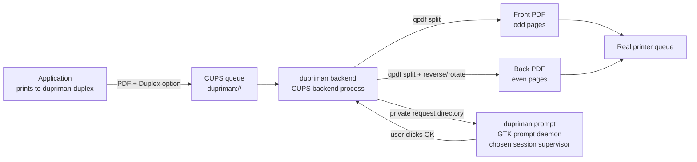

# DupriMan — Manual Duplex Printing Assistant

**English** | [简体中文](README.zh_CN.md) | [繁體中文](README.zh_TW.md)

Gives **single-sided printers** a near-automatic duplex experience:
In any application's print dialog, select the virtual printer **dupriman-duplex** and choose
**Off / Long-edge / Short-edge** duplex. It will:

1. Print **all fronts** (odd pages, all copies);
2. Show a GTK dialog prompting to reinsert the paper;
3. Print **all backs** (even pages) after you click **OK**.

## Architecture



- **Backend** (`dupriman backend`, called by cupsd): parses duplex options, splits odd/even pages with qpdf, submits to the real queue and **waits for physical completion** before proceeding.
- **Prompt daemon** (`dupriman prompt`, runs in the user's graphical session): the backend creates a private directory for the submitting user below `/run/dupriman`. Requests and responses are owner-checked and capability-bound, so another local user cannot read job metadata or approve a job. Cancel or timeout safely aborts the back-side job.
- **Multiple copies**: The PPD declares `cupsManualCopies`, so copies are passed through to the real queue — all fronts (×N) first, one prompt, then all backs (×N).

## Dependencies

Runtime: `cups`, `qpdf`, `poppler` (pdfinfo), `gtk4` (>= 4.10)
Build: `rust` / `cargo`, `pkg-config`

Arch Linux:

```bash
sudo pacman -S --needed cups qpdf poppler gtk4 rust
```

## Manual Integration

### Arch Linux:

```bash
paru -S dupriman-git
```

DupriMan deliberately does not install files, create queues, manage runtime
directories, or enable a service.  Packages and administrators own those
actions so the program works with any init system.

### From source

```bash
cargo build --release
```

Install the binary, CUPS backend symlink, and PPD through your package manager
or chosen prefix.  Generate the PPD with `dupriman ppd`; generate an annotated
configuration with `dupriman sample-config`.  Then complete the system-specific
integration explicitly:

```bash
sudo install -d -o root -g root -m 0711 /run/dupriman
sudo install -d -o lp -g lp -m 0700 /var/tmp/dupriman
sudo install -d -m 0755 /etc/dupriman
sudo sh -c 'dupriman sample-config > /etc/dupriman/config.toml'
sudo lpadmin -p dupriman-duplex -v dupriman://duplex \
  -P /usr/share/cups/model/dupriman.ppd -E
```

Set `printer.real` and explicitly list permitted desktop accounts in
`prompt.allowed_users`.  CUPS normally runs backends as `lp`.  For every
permitted account, create a dedicated bridge group and the private layout below;
replace `alice` with that account name:

```bash
sudo groupadd --system dupriman-alice
sudo usermod -a -G dupriman-alice alice
sudo usermod -a -G dupriman-alice lp
sudo install -d -o root -g root -m 0711 /run/dupriman/alice
sudo install -d -o lp -g dupriman-alice -m 2750 /run/dupriman/alice/requests
sudo install -d -o alice -g dupriman-alice -m 2770 /run/dupriman/alice/responses
```

The backend writes requests as `lp`; the desktop user reads them and writes
responses.  Other local users receive no access, while response UID and a random
capability are still verified before backs print.  Log out and back in after
changing group membership.  Finally, supervise `dupriman prompt` in each
permitted graphical session using your init system, desktop autostart mechanism,
or service manager.  A systemd user unit may be useful as a local example, but
is not installed or enabled by DupriMan.

## Configuration

**You should add your physical printer by yourself with CUPS first.**

The backend reads only `/etc/dupriman/config.toml` (and an explicit `--config`
argument).  User-level configuration is for prompt presentation only; do not
override printer or path settings there.  Full annotated example: `dupriman sample-config`.

Key options (defaults work for most face-down-output laser printers):

```toml
[printer]
#Special value "save pdf": Do not print, save sub jobs to spool-dir/saved/(test mode, default)
#When printing on a real machine, change to the actual queue name, such as "HP_LaserJet_1020" (check with lpstat -v)
real = "HP_LaserJet_1020"        # Real printer queue name, check with lpstat -v

[duplex]
even_order = "reverse"           # Back page order: reverse | normal

[duplex.long_edge]
even_rotate = 180                # Long-edge flip: back rotation angle

[duplex.short_edge]
even_rotate = 0                  # Short-edge flip: back rotation angle

[prompt]
language = "auto"                # Dialog language: auto | en | zh_CN | zh_TW
timeout_secs = 600               # 0 = wait forever; timeout aborts
allowed_users = ["alice"]         # Accounts allowed to approve duplex jobs
```

### Internationalization (i18n)

Dialog text is selected by `prompt.language`:

| Value | Language |
|---|---|
| `auto` | Detect from `LANG` / `LC_ALL` (default) |
| `en` / `en_US` | English |
| `zh_CN` | Simplified Chinese |
| `zh_TW` | Traditional Chinese |

You can also override any text directly:

```toml
[prompt]
title = "My Custom Title"
message = "Please reinsert the paper"
ok_label = "Continue"
cancel_label = "Stop"
```

Custom text always takes precedence over language defaults.

### Wrong orientation or order?

Defaults assume a **face-down output tray** and the user action of
**taking the stack from the output tray and reinserting it as-is**:

| Symptom | Fix |
|---|---|
| Back order reversed (last page on top) | `duplex.even_order = "normal"` |
| Back upside-down (long-edge) | `duplex.long_edge.even_rotate = 0` |
| Back upside-down (short-edge) | `duplex.short_edge.even_rotate = 180` |
| Face-up output printer (e.g., some inkjets) | `duplex.even_order = "normal"` + swap the two `even_rotate` values |

Test with a 3–4 page document first.

## Usage

In the print dialog, select **dupriman-duplex** and choose duplex mode:

- **Off**: forwards directly to the real printer;
- **Long-edge** (default): for portrait documents flipped along the long edge (backs rotated 180°);
- **Short-edge**: for landscape documents flipped along the short edge (backs not rotated).

After fronts are printed, **do not flip or reorder** — take the stack from the output tray and reinsert it into the input tray as-is, then click OK.

## Logs & Troubleshooting

- Backend logs: `journalctl -u cups` or `/var/log/cups/error_log` (`[dupriman]` prefix)
- Prompt daemon: inspect the logs of the session supervisor you chose
- Self-check: `dupriman test`
- If the prompt daemon is not running when duplex is requested: fronts print, then the backend waits and safely aborts after `prompt.timeout_secs`.
- Debug split results: set `print.keep_temp = true`; temporary PDFs are kept in `paths.spool_dir`.

## Removal

Remove the package with your package manager, stop the prompt service through
its owning session manager, and remove the CUPS queue with
`lpadmin -x dupriman-duplex` if it is no longer wanted.  Configuration and
runtime directories are explicitly administrator-owned state.

## Development

```bash
cargo test            # Unit tests + real qpdf split test
tests/e2e.sh          # End-to-end simulation (mock lp/lpstat, no paper wasted)
cupstestppd <(./target/debug/dupriman ppd)   # Validate PPD
```

### Adding a new language

1. Create `i18n/<locale>.toml` from `i18n/en_US.toml` and translate all keys.
2. Register in `src/i18n.rs` (all in one place):
   - `Lang` enum: add variant with serde rename + alias
   - `Lang::ALL`: add the new variant
   - `Lang::from_env()`: add language detection from `LANG`/`LC_ALL`
   - `Lang::file_stem()`: map to the locale filename stem
3. Update the language table in [Internationalization](#internationalization-i18n) (optional).

Missing keys fall back to `en_US` automatically.  `dupriman ppd` reads the
language list from `Lang::ALL`, so no packaging-script changes are needed.

### Tested hardware

This software has only been tested on **HP LaserJet 1020** with the **foo2zjs** driver in **Arch Linux**.
If you test it on other printer models or drivers, please report your results or send a PR, 
especially the correct `even_order` and `even_rotate` values for your setup.
