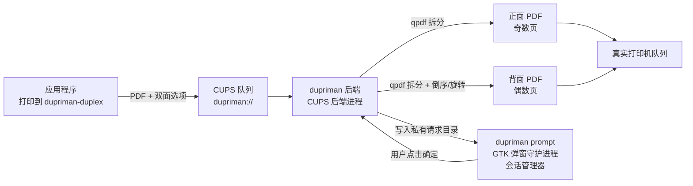

# DupriMan — 手动双面打印助手

[English](README.md) | **简体中文** | [繁體中文](README.zh_TW.md)

为**单面打印机**提供近乎自动的双面打印体验：
在任意应用的打印对话框中，选择虚拟打印机 **dupriman-duplex**，并选择
**关闭 / 长边翻转 / 短边翻转** 双面模式。它将：

1. 打印**所有正面**（奇数页，全部份数）；
2. 弹出 GTK 对话框，提示重新放入纸张；
3. 点击**确定**后打印**所有背面**（偶数页）。

## 架构



- **后端**（`dupriman backend`，由 cupsd 调用）：解析双面选项，用 qpdf 拆分奇偶页，提交到真实打印机队列，并在继续之前**等待物理打印完成**。
- **弹窗守护进程**（`dupriman prompt`，运行在用户图形会话中）：后端会在 `/run/dupriman` 下为提交用户创建私有目录。请求与响应均校验文件所有者和随机 capability，本机其他用户无法读取任务元数据或伪造确认。取消或超时会安全中止背面打印任务。
- **多份拷贝**：PPD 声明了 `cupsManualCopies`，因此份数会透传到真实队列——先打印全部正面（×N），弹窗一次，再打印全部背面（×N）。

## 依赖

运行时：`cups`、`qpdf`、`poppler`（pdfinfo）、`gtk4`（>= 4.10）
构建：`rust` / `cargo`、`pkg-config`

Arch Linux：

```bash
sudo pacman -S --needed cups qpdf poppler gtk4 rust
```

## 手动集成

### Arch Linux:

```bash
paru -S dupriman-git
```

### 从源码安装

```bash
cargo build --release
```

DupriMan 不会自行安装文件、创建 CUPS 队列、管理运行目录或启用服务。
包管理器和管理员必须显式拥有这些动作，因而可适配任意 init 系统。
安装二进制、CUPS backend 符号链接及 `dupriman ppd` 生成的 PPD 后，执行：

```bash
sudo install -d -o root -g root -m 0711 /run/dupriman
sudo install -d -o root -g root -m 0700 /var/tmp/dupriman
sudo install -d -m 0755 /etc/dupriman
sudo sh -c 'dupriman sample-config > /etc/dupriman/config.toml'
sudo lpadmin -p dupriman-duplex -v dupriman://duplex \
  -P /usr/share/cups/model/dupriman.ppd -E
```

配置 `printer.real` 与明确的 `prompt.allowed_users`。CUPS backend 必须以
`lp` 用户运行。每个允许的账户均须创建专用 bridge group 和私有目录布局；
以下以 `alice` 为例：

```bash
sudo groupadd --system dupriman-alice
sudo usermod -a -G dupriman-alice alice
sudo usermod -a -G dupriman-alice lp
sudo install -d -o root -g root -m 0711 /run/dupriman/alice
sudo install -d -o lp -g dupriman-alice -m 2750 /run/dupriman/alice/requests
sudo install -d -o alice -g dupriman-alice -m 2770 /run/dupriman/alice/responses
```

backend 以 `lp` 写入请求，图形用户读取请求并写入响应。其他本地用户没有访问
权限，且打印背面前仍会验证响应 UID 和随机 capability。修改组成员后需注销再登录。
最后用所选 init、桌面 autostart 或会话管理器在每个允许的图形会话中监管
`dupriman prompt`。systemd user unit 只能作为本地示例，DupriMan 不会安装或启用它。

## 配置

**你应当先使用CUPS添加你的真实打印机。**

backend 只读取 `/etc/dupriman/config.toml` 和显式的 `--config` 参数。
用户级配置只适合覆盖弹窗文案；不要在那里覆盖打印机或路径设置。完整注释示例：`dupriman sample-config`。

关键选项（默认值适用于大多数出纸面朝下的激光打印机）：

```toml
[printer]
# 特殊值 "save-pdf"：不打印，子作业保存到 spool_dir/saved/（测试模式，默认）
# 真机打印时改为实际队列名，如 "HP_LaserJet_1020"（lpstat -v 查看）
real = "save-pdf"

[duplex]
even_order = "reverse"           # 背面页序：reverse（倒序）| normal（正序）

[duplex.long_edge]
even_rotate = 180                # 长边翻转：背面旋转角度

[duplex.short_edge]
even_rotate = 0                  # 短边翻转：背面旋转角度

[prompt]
language = "auto"                # 对话框语言：auto | en | zh_CN | zh_TW
timeout_secs = 600               # 0 = 永久等待；超时后中止
allowed_users = ["alice"]         # 允许确认双面作业的本地账户
```

### 国际化（i18n）

对话框文本由 `prompt.language` 选择：

| 值 | 语言 |
|---|---|
| `auto` | 从 `LANG` / `LC_ALL` 自动检测（默认） |
| `en` / `en_US` | 英语 |
| `zh_CN` | 简体中文 |
| `zh_TW` | 繁体中文 |

也可以直接覆盖任意文本：

```toml
[prompt]
title = "自定义标题"
message = "请重新放入纸张"
ok_label = "继续"
cancel_label = "停止"
```

自定义文本始终优先于语言默认值。

### 方向或页序不对？

默认值假设**出纸面朝下的输出托盘**，用户操作是
**从输出托盘取出整叠纸，原样放回进纸槽**：

| 症状 | 修复方法 |
|---|---|
| 背面页序反了（最后一页在最上面） | `duplex.even_order = "normal"` |
| 背面颠倒（长边翻转） | `duplex.long_edge.even_rotate = 0` |
| 背面颠倒（短边翻转） | `duplex.short_edge.even_rotate = 180` |
| 出纸面朝上的打印机（如部分喷墨） | `duplex.even_order = "normal"` + 对调两个 `even_rotate` 值 |

建议先用 3–4 页的文档测试。

## 使用方法

在打印对话框中选择 **dupriman-duplex**，然后选择双面模式：

- **关闭**：直接转发到真实打印机；
- **长边翻转**（默认）：适用于纵向文档，沿长边翻转（背面旋转 180°）；
- **短边翻转**：适用于横向文档，沿短边翻转（背面不旋转）。

正面打印完成后，**不要翻转或重新排序**——从输出托盘取出整叠纸，原样放入进纸槽，然后点击确定。

## 日志与故障排除

- 后端日志：`journalctl -u cups` 或 `/var/log/cups/error_log`（前缀 `[dupriman]`）
- 弹窗守护进程：查看所选会话管理器的日志
- 自检：`dupriman test`
- 如果请求双面打印时弹窗守护进程未运行：正面会正常打印，之后后端等待并在 `prompt.timeout_secs` 后安全中止。
- 调试拆分结果：设置 `print.keep_temp = true`；临时 PDF 将保留在 `paths.spool_dir` 中。

## 移除

用包管理器删除软件包，用其所属会话管理器停止 prompt 服务；如不再使用队列，
执行 `lpadmin -x dupriman-duplex`。配置与运行目录由管理员显式管理。

## 开发

```bash
cargo test            # 单元测试 + 真实 qpdf 拆分测试
tests/e2e.sh          # 端到端模拟（mock lp/lpstat，不浪费纸张）
cupstestppd <(./target/debug/dupriman ppd)   # 验证 PPD
```

### 添加新语言

1. 从 `i18n/en_US.toml` 复制创建 `i18n/<locale>.toml`，翻译所有键。
2. 在 `src/i18n.rs` 中注册（全部集中在一处）：
   - `Lang` 枚举：添加变体，带上 serde rename 和 alias
   - `Lang::ALL`：加入新变体
   - `Lang::from_env()`：添加从 `LANG`/`LC_ALL` 检测语言的逻辑
   - `Lang::file_stem()`：映射到语言文件名
3. 更新[国际化](#国际化i18n)中的语言表（可选）。

缺失的键会自动回退到 `en_US`。`dupriman ppd` 通过 `Lang::ALL` 自动发现所有语言，无需修改打包脚本。

### 已测试硬件

本软件仅在 **Arch Linux** 上的 **HP LaserJet 1020** + **foo2zjs** 驱动上测试过。
如果你在其他打印机型号或驱动上测试，欢迎反馈结果或提交 PR，
尤其是适合你设备的 `even_order` 和 `even_rotate` 配置值。
