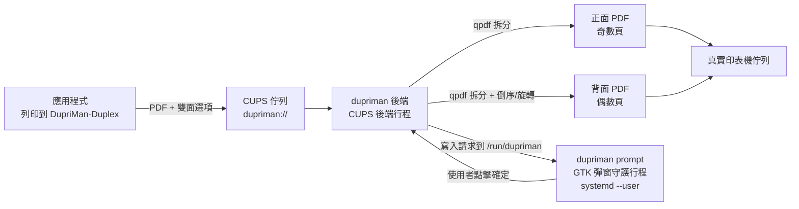

# DupriMan — 手動雙面列印助手

[English](README.md) | [简体中文](README.zh_CN.md) | **繁體中文**

為**單面印表機**（如 HP LaserJet 1020，foo2zjs 驅動）提供近乎自動的雙面列印體驗：
在任意應用的列印對話框中，選擇虛擬印表機 **DupriMan-Duplex**，並選擇
**關閉 / 長邊翻轉 / 短邊翻轉** 雙面模式。它將：

1. 列印**所有正面**（奇數頁，全部份數）；
2. 彈出 GTK 對話框，提示重新放入紙張；
3. 點擊**確定**後列印**所有背面**（偶數頁）。

## 架構



- **後端**（`dupriman backend`，由 cupsd 呼叫）：解析雙面選項，用 qpdf 拆分奇偶頁，提交到真實印表機佇列，並在繼續之前**等待實體列印完成**。
- **彈窗守護行程**（`dupriman prompt`，執行於使用者圖形工作階段）：CUPS 後端以 `cups` 使用者身分執行，無法顯示對話框，因此透過 `/run/dupriman` 中的請求/回應檔案進行通訊。守護行程顯示 GTK4 對話框。取消或逾時會安全中止背面列印工作。
- **多份拷貝**：PPD 宣告了 `cupsManualCopies`，因此份數會透傳到真實佇列——先列印全部正面（×N），彈窗一次，再列印全部背面（×N）。

## 依賴

執行時：`cups`、`qpdf`、`poppler`（pdfinfo）、`gtk4`（≥ 4.10）、`systemd`
建構：`rust` / `cargo`、`pkg-config`

Arch Linux：

```bash
sudo pacman -S --needed cups qpdf poppler gtk4 rust
```

## 安裝

### Arch Linux:

```bash
paru -S dupriman-git
```

### 從原始碼安裝

```bash
cargo build --release
sudo ./target/release/dupriman install
```

`install` 按 FHS 規範放置檔案並啟用：

| 路徑 | 說明 |
|---|---|
| `/usr/bin/dupriman` | 主程式 |
| `/usr/lib/cups/backend/dupriman` | CUPS 後端（符號連結） |
| `/usr/share/cups/model/dupriman.ppd` | 虛擬印表機 PPD |
| `/etc/dupriman/config.toml` | 系統級設定（已存在時不覆蓋） |
| `/usr/lib/systemd/user/dupriman-prompt.service` | 彈窗守護行程（全域啟用） |
| `/usr/lib/tmpfiles.d/dupriman.conf` | 狀態/暫存目錄 |
| `/usr/share/dupriman/i18n/` | 介面翻譯檔案 |

然後啟動彈窗服務（或重新登入）：

```bash
systemctl --user start dupriman-prompt
dupriman test   # 環境自檢
```

## 設定

系統級：`/etc/dupriman/config.toml`；使用者級覆蓋：`~/.config/dupriman/config.toml`
（只需寫入要覆蓋的欄位）。完整註解範例：`dupriman sample-config`。

關鍵選項（預設值適用於大多數出紙面朝下的雷射印表機）：

```toml
[printer]
# 特殊值 "save-pdf"：不列印，子作業儲存到 spool_dir/saved/（測試模式，預設）
# 實機列印時改為實際佇列名，如 "HP_LaserJet_1020"（lpstat -v 查看）
real = "save-pdf"

[duplex]
even_order = "reverse"           # 背面頁序：reverse（倒序）| normal（正序）

[duplex.long_edge]
even_rotate = 180                # 長邊翻轉：背面旋轉角度

[duplex.short_edge]
even_rotate = 0                  # 短邊翻轉：背面旋轉角度

[prompt]
language = "auto"                # 對話框語言：auto | en | zh_CN | zh_TW
timeout_secs = 600               # 0 = 永久等待；逾時後中止
```

### 國際化（i18n）

對話框與 CLI 提示語言由 `prompt.language` 控制：

| 值 | 語言 |
|---|---|
| `auto` | 從 `LANG` / `LC_ALL` 自動偵測（預設） |
| `en` / `en_US` | 英語 |
| `zh_CN` | 簡體中文 |
| `zh_TW` | 繁體中文 |

翻譯檔案在 `/usr/share/dupriman/i18n/<locale>.toml`，可直接編輯或新增語言。
也可以直接在設定裡覆蓋任意文案（優先級最高）：

```toml
[prompt]
title = "我的自訂標題"
message = "請把紙放回去"
ok_label = "繼續"
cancel_label = "停止"
```

### 方向或頁序不對？

預設值假設**出紙面朝下的輸出紙盤**，使用者操作是
**從輸出紙盤取出整疊紙，原樣放回進紙槽**：

| 症狀 | 修復方法 |
|---|---|
| 背面頁序反了（最後一頁在最上面） | `duplex.even_order = "normal"` |
| 背面顛倒（長邊翻轉） | `duplex.long_edge.even_rotate = 0` |
| 背面顛倒（短邊翻轉） | `duplex.short_edge.even_rotate = 180` |
| 出紙面朝上的印表機（如部分噴墨） | `duplex.even_order = "normal"` + 對調兩個 `even_rotate` 值 |

建議先用 3–4 頁的文件測試（測試模式下檢查 `/var/tmp/dupriman/saved/` 的 PDF 即可，不耗紙）。

## 使用方法

在列印對話框中選擇 **DupriMan-Duplex**，然後選擇雙面模式：

- **關閉**：直接轉發到真實印表機；
- **長邊翻轉**（預設）：適用於縱向文件，沿長邊翻轉（背面旋轉 180°）；
- **短邊翻轉**：適用於橫向文件，沿短邊翻轉（背面不旋轉）。

正面列印完成後，**不要翻轉或重新排序**——從輸出紙盤取出整疊紙，原樣放入進紙槽，然後點擊確定。

## 日誌與故障排除

- 後端日誌：`journalctl -u cups` 或 `/var/log/cups/error_log`（前綴 `[dupriman]`）
- 彈窗守護行程：`journalctl --user -u dupriman-prompt`
- 自檢：`dupriman test`
- 如果請求雙面列印時彈窗守護行程未執行：正面會正常列印，之後後端等待並在 `prompt.timeout_secs` 後安全中止。
- 偵錯拆分結果：設定 `print.keep_temp = true`；暫存 PDF 將保留在 `paths.spool_dir` 中。

## 解除安裝

```bash
sudo dupriman uninstall            # 移除印表機/服務/系統檔案，保留設定
sudo dupriman uninstall --purge    # 同時移除設定和二進位檔案
```

## 開發

```bash
cargo test            # 單元測試 + 真實 qpdf 拆分測試
tests/e2e.sh          # 端到端模擬（save-pdf 模式，不耗紙）
cupstestppd <(./target/debug/dupriman ppd)   # 驗證 PPD
```

### 新增語言

1. 從 `i18n/en_US.toml` 複製建立 `i18n/<locale>.toml`，翻譯所有鍵。
2. 在 `src/i18n.rs` 中註冊（全部集中在一處）：
   - `Lang` 列舉：新增變體，帶上 serde rename 和 alias
   - `Lang::ALL`：加入新變體
   - `Lang::from_env()`：新增從 `LANG`/`LC_ALL` 偵測語言的邏輯
   - `Lang::file_stem()`：對應到語言檔名
   - `Lang::raw_toml()`：新增 `include_str!("../i18n/<stem>.toml")` 分支
3. 更新[國際化](#國際化i18n)中的語言表（可選）。

缺失的鍵會自動回退到 `en_US`。`install` 透過 `Lang::ALL` 自動發現所有語言，無需修改安裝腳本。

### 已測試硬體

本軟體僅在 **Arch Linux** 上的 **HP LaserJet 1020** + **foo2zjs** 驅動上測試過。
如果你在其他印表機型號或驅動上測試，歡迎回報結果或提交 PR，
尤其是適合你裝置的 `even_order` 和 `even_rotate` 設定值。
